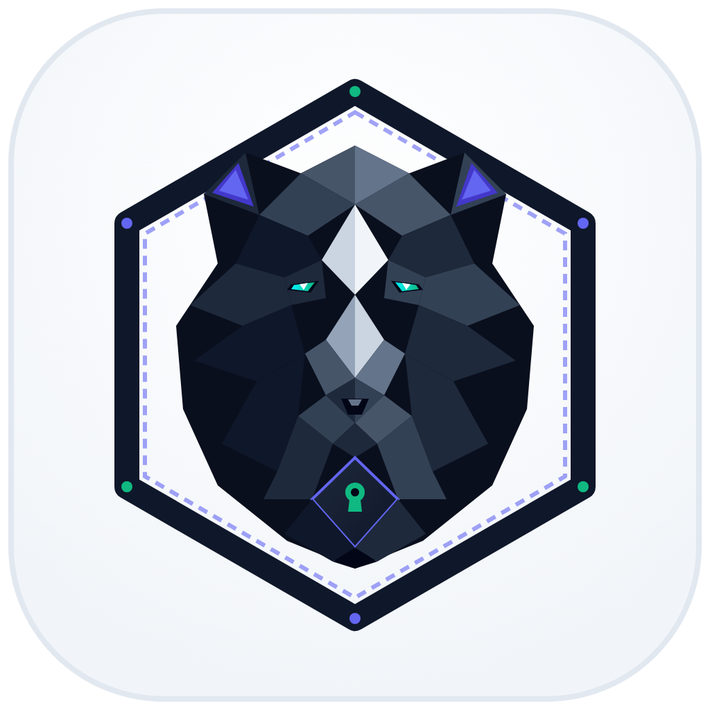
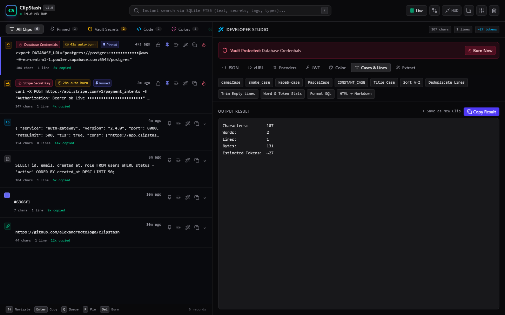
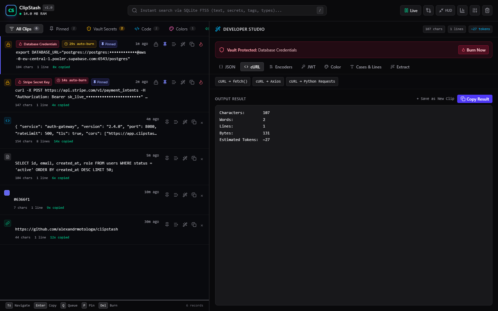
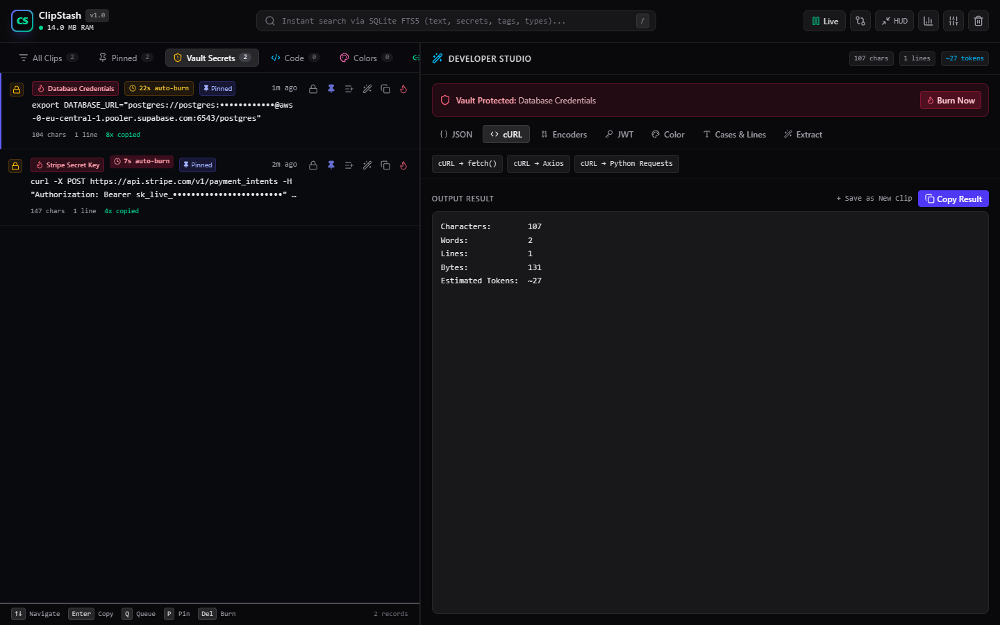
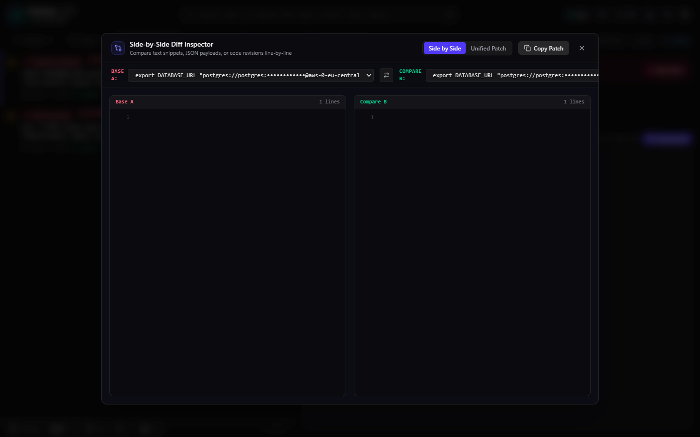
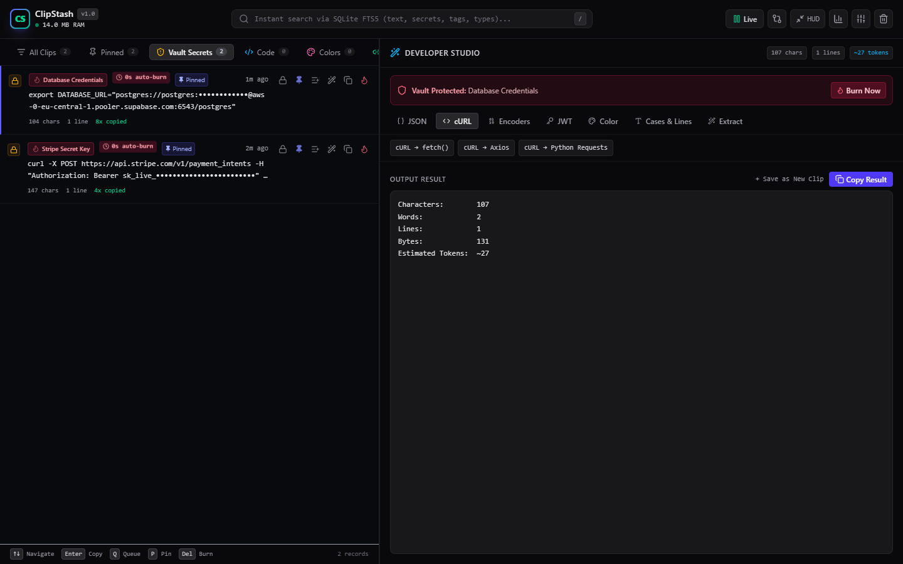

<p align="center">
  
</p>

<h1 align="center">ClipStash</h1>

<p align="center">
  <strong>Local-first smart clipboard manager, secret-masking vault, and developer transformation studio built with Rust, Tauri v2, and React 19.</strong>
</p>

<p align="center">
  
  
  
  
  
  
  
</p>

---

## Overview

Traditional desktop clipboard managers frequently consume 300MB to 500MB of resident RAM because they package a full Chromium runtime via Electron. More critically, they persist passwords, bearer tokens, and private API keys copied from terminal sessions or `.env` files directly to plain disk storage without encryption or masking.

ClipStash addresses this problem directly. Written in Rust and Tauri v2 with a React 19 interface, it operates under 15MB of RAM, encrypts all captured clips at rest using AES-256-GCM, automatically detects and masks sensitive credentials, shreds temporary secrets after 60 seconds, and provides single-key code conversions for developers.

<p align="center">
  
</p>

---

## Key Capabilities

### 1. Ultra-Low Resource Footprint
- Native Rust engine paired with system webviews.
- Resident memory footprint stays under 15MB RAM during continuous operation.
- Non-blocking clipboard listener with deduplication and self-copy suppression.
- Instant summon via global keyboard shortcut (`Alt + V`).

### 2. Automatic Secret Masking and Ephemeral Shredding
- Scans every clipboard item through compiled regular expressions and entropy estimators.
- Detects AWS IAM keys, GitHub tokens (`ghp_`), OpenAI keys (`sk-proj-`), Anthropic tokens, Google API keys, Stripe secret keys, Slack tokens, private certificates, and database connection strings.
- Validates credit card candidates with the Luhn checksum algorithm before classification.
- Visually replaces sensitive characters with masked placeholders (`••••••••••••`).
- Configures an automatic purge timer (default 60 seconds) that permanently erases expired credentials from both SQLite and memory.

### 3. Sensitive App Privacy Guard
- Automatically detects when the foreground active window is a known password manager (1Password, Bitwarden, KeePass, KeePassXC, LastPass, Dashlane, ProtonPass, Authy).
- Bypasses clipboard ingestion while copying from these credential managers, preventing master passwords and one-time tokens from entering clipboard history.

### 4. Sequential Paste Queue
- Queue multiple clipboard items with `Q` or the queue button for sequential filling workflows.
- Pop and copy the next queued item with `Shift + Enter` without switching back and forth between applications.
- Visual status bar tracks remaining queue count and current item previews.

### 5. Quick HUD Mode
- Lightweight floating palette optimized for rapid single-character lookups.
- Top 9 clipboard records are bound directly to keys `1` through `9` for instant copying.
- Toggle between full dual-pane studio workspace and HUD mode with `Tab` or the header toggle.

### 6. Side-by-Side Diff Inspector
- Built-in line diff engine using the Myers algorithm.
- Compare any two clipboard records side by side or as a unified patch with colored line additions and deletions.
- Export unified Git patches with a single click.

### 7. Encrypted Vault Backup Export and Import
- Export entire clipboard history into portable `.clipstash` JSON backup files encrypted with AES-256-GCM.
- Derives a 256-bit encryption key from user-chosen passphrases with 5,000 rounds of SHA-256 key stretching and 16-byte random salts.
- Import encrypted backups seamlessly into fresh ClipStash installations.

### 8. Developer Transformation Studio
- **JSON Workbench**: Format 2-space, format 4-space, minify, convert to YAML, generate TypeScript interfaces, generate Go structs, or generate Rust structs with Serde attributes.
- **cURL Converter**: Translates raw terminal cURL commands into JavaScript `fetch()`, Axios requests, or Python `requests` scripts.
- **Encoders and Decoders**: Bi-directional UTF-8 Base64, URL encode/decode, Hex, Binary, and Unix timestamp/epoch conversions.
- **SQL Formatter**: Formats and beautifies SQL queries with capitalized keywords and clause indentation.
- **HTML to Markdown**: Converts rich HTML snippets, headings, code blocks, lists, and links into clean GitHub-flavored Markdown.
- **Token Inspector**: Decodes JWT headers and payload claims, displaying human-readable expiration dates and validity status.
- **Color Studio**: Converts HEX, RGB, RGBA, and HSL values while generating CSS variables.
- **Text and Regex Utilities**: Formats camelCase, snake_case, kebab-case, PascalCase, CONSTANT_CASE, and Title Case. Extracts email addresses, URLs, IPv4 addresses, and UUIDs. Sorts and deduplicates lines.

---

## Screen Walkthrough

### Main Dual-Pane Workspace
The left panel presents the indexed clip list with category filters (All, Pinned, Secrets, Code, Colors, Links), secret indicator badges, and auto-burn countdown timers. The right panel houses the Developer Transformation Studio.

<p align="center">
  
</p>

### Developer Transformation Studio
Paste or select any cURL command or JSON payload to inspect and convert it instantly across languages.

<p align="center">
  
</p>

### Cryptographic Secret Vault
Tokens and sensitive variables are masked upon arrival. Users can reveal the original text with intentional focus or click "Burn Now" to wipe the payload immediately.

<p align="center">
  
</p>

### Side-by-Side Diff Inspector
Compare any two clipboard snippets side by side with colored line additions and deletions, or generate unified Git patches with a single click.

<p align="center">
  
</p>

### Quick HUD Palette Mode
Floating command palette accessible with Tab or header shortcut, binding the top 9 clipboard records directly to number keys 1 through 9 for rapid copying without mouse interaction.

<p align="center">
  
</p>

### Performance and Telemetry
Benchmarks demonstrate the contrast between ClipStash and conventional Electron clipboard utilities.

<p align="center">
  
</p>

---

## Architecture

```
clipstash/
├── src/                          # React 19 Frontend
│   ├── components/               # UI components
│   │   ├── Header.tsx            # FTS5 search, pause, HUD & diff toggles
│   │   ├── CategoryTabs.tsx      # Category filters & counters
│   │   ├── ClipList.tsx          # Keyboard navigable list
│   │   ├── ClipItem.tsx          # Clip item view, queue button, countdowns
│   │   ├── CompactHud.tsx        # Fast Spotlight/Raycast palette (1..9 keys)
│   │   ├── DiffModal.tsx         # Side-by-side & unified Myers diff inspector
│   │   ├── PasteQueueBar.tsx     # Sequential paste dock & status bar
│   │   ├── StudioDrawer.tsx      # Developer transformation studio
│   │   ├── StatsModal.tsx        # Telemetry & performance dialog
│   │   └── SettingsModal.tsx     # Encrypted backup & privacy preferences
│   ├── hooks/
│   │   └── useClips.ts           # Tauri IPC state bridge, queue & listeners
│   ├── lib/
│   │   ├── audio.ts              # Web Audio tactile sound effects
│   │   ├── diff.ts               # Myers line diff & patch formatter
│   │   ├── diff.test.ts          # Vitest diff unit tests (3 tests)
│   │   ├── transformers.ts       # Developer transformers (JSON, Go, Rust, SQL)
│   │   └── transformers.test.ts  # Vitest transformer tests (23 tests)
│   ├── types/
│   │   └── clip.ts               # TypeScript data definitions
│   └── App.tsx                   # Root dual-pane application
├── src-tauri/                    # Rust Backend Core
│   ├── src/
│   │   ├── clipboard.rs          # Monitor thread & sensitive app guard
│   │   ├── commands.rs           # Tauri command dispatch handlers
│   │   ├── crypto.rs             # AES-256-GCM machine & passphrase encryption
│   │   ├── db.rs                 # SQLite connection, FTS5 & vault export/import
│   │   ├── detector.rs           # Secret regexes, process detector & Luhn
│   │   ├── lib.rs                # Tauri builder & tray icon menu
│   │   └── main.rs               # Windows subsystem entrypoint
│   ├── tests/
│   │   └── unit_tests.rs         # Rust integration test suite (17 tests)
│   ├── Cargo.toml                # Rust crate definitions
│   └── tauri.conf.json           # Tauri bundle configuration
└── package.json                  # Node dependencies & build scripts
```

---

## Keyboard Shortcuts

| Shortcut | Context | Action |
| :--- | :--- | :--- |
| `Alt + V` | System | Summon or hide the ClipStash application window |
| `Tab` / `HUD` | App | Toggle Quick HUD mode (floating palette) |
| `1` to `9` | HUD Mode | Instantly copy corresponding numbered clip |
| `Shift + Enter` | App | Pop and copy next item from Sequential Paste Queue |
| `Q` | Clip List | Add selected clip to Sequential Paste Queue |
| `/` or `Ctrl + F` | App | Focus the FTS5 search input |
| `↑` / `↓` | Clip List | Navigate up and down through clipboard records |
| `Enter` | Clip List | Copy selected clip to clipboard |
| `P` | Clip List | Toggle pinned status on the selected clip |
| `Delete` | Clip List | Delete clip or immediately burn secret |
| `Escape` | Modal / HUD | Dismiss dialog, exit HUD, or close preferences |

---

## Building and Running

### Prerequisites
- Node.js 20 or higher
- Rust toolchain 1.85 or higher (`rustup default stable`)
- Platform C compiler (MSVC on Windows, GCC/Clang on Linux, Xcode command line tools on macOS)

### 1. Clone the repository
```bash
git clone https://github.com/alexandrmotologa/clipstash.git
cd clipstash
```

### 2. Install dependencies
```bash
npm install
```

### 3. Run frontend unit tests
```bash
npm run test
```

### 4. Run Rust unit tests
```bash
cargo test --test unit_tests --manifest-path src-tauri/Cargo.toml
```

### 5. Start development mode
```bash
npm run tauri dev
```

### 6. Build production desktop application
```bash
npm run tauri build
```

---

## Security Model

1. **Zero Plaintext Storage**: Clip text is encrypted with an AES-256-GCM key generated locally on the host machine. If an unauthorized process reads `clipstash.db`, it encounters only encrypted ciphertext and truncated FTS search tokens.
2. **Ephemeral Credentials**: When sensitive patterns match, ClipStash sets an expiration deadline. The background sweeper checks this timestamp every 4 seconds, permanently dropping expired records.
3. **Sensitive Process Auto-Bypass**: Actively monitors foreground process identifiers to suppress clipboard ingestion whenever 1Password, Bitwarden, KeePassXC, or other credential vaults copy passwords or OTP codes.
4. **Encrypted Portable Backups**: Exports are secured through user-derived AES-256-GCM encryption with 5,000 iterations of SHA-256 key stretching, preventing unauthorized offline exposure.
5. **No External Network Calls**: ClipStash functions completely offline. No telemetry, clips, or tokens leave the local device.

---

## License

MIT License. See [LICENSE](LICENSE) for terms.
